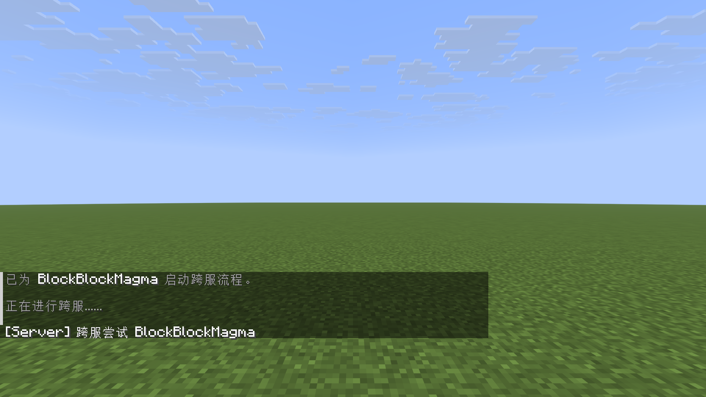

# ZthEvent2611Oj233Helper

元竞 鱼来 KOIKOI 活动服务器的进服引导插件。

玩家进入服务器后会被切换为旁观模式、收到活动说明与跨服提示，插件随后按固定间隔重复执行配置好的跨服命令；超过设定时间仍未离开本服的玩家会被踢出。真正的跨服由其他插件完成（例如 OhMyTransfer），本插件只负责流程控制与命令触发。

## 功能特性

- 玩家进服后自动切换旁观模式（模式可配置，也可关闭进服自动流程）。
- 聊天栏提示分为两部分：活动说明（可点击 `[不再提示]` 永久隐藏）与「正在进行跨服......」。
  消息开头、结尾以及两部分之间各留一行空行；空行数量可配置。
- 玩家点击 `[不再提示]` 的选择按 UUID 记录在独立的 `player-data.yml` 中，重启后依然生效。
- 按配置的间隔执行一整组命令，例如每 10 秒一次、最多 3 次；命令由控制台执行，
  支持 `{player}`（玩家名）与 `{uuid}`（玩家 UUID）占位符。
- 超过「间隔 × 次数」仍未离开本服时踢出玩家，踢出消息可配置。
- 玩家相关操作全部通过玩家的 EntityScheduler 调度，按 Paper / Folia 通用线程模型编写。
- 管理命令 `/zth-event reload` 可在不重启服务器的情况下重载配置。

## 环境要求

| 项目 | 要求 |
| --- | --- |
| 服务端 | Paper 26.1.2+（线程模型同时兼容 Folia） |
| 运行时 | Java 25 |
| 跨服插件 | 任意能通过命令触发跨服的插件（示例使用 OhMyTransfer 的 `/omt`） |

## 安装与快速开始

1. 构建插件（见下文「构建」）或取得 `ZthEvent2611Oj233Helper-1.0.0.jar`。
2. 将 jar 放入服务端的 `plugins/` 目录并启动一次服务器。
3. 编辑 `plugins/ZthEvent2611Oj233Helper/config.yml`，把 `flow.commands` 改成实际的跨服命令。
   使用 OhMyTransfer 时通常是：

   ```yaml
   flow:
     commands:
       - "omt {player} koikoi"   # koikoi 换成 OhMyTransfer 配置中的目标服务器键名
   ```

4. 执行 `/zth-event reload`（或重启服务器）使配置生效。
5. 玩家进服后应被切换为旁观模式并看到提示；跨服成功后流程随玩家离开而结束。

## 流程说明

| 时间 | 行为 |
| --- | --- |
| t = 0 | 切换为旁观模式，发送聊天栏提示，执行第 1 次跨服命令 |
| t = 10 秒 | 第 2 次执行跨服命令 |
| t = 20 秒 | 第 3 次执行跨服命令 |
| t = 30 秒 | 玩家仍在本服则踢出，并显示配置的踢出消息 |

玩家在中途被传送到其他服务器（或自行退出）时，流程与后续任务会自动结束。
间隔与次数由 `flow.interval-seconds`、`flow.attempts` 控制，总超时即两者相乘。

## 效果

进服后的聊天栏提示（空行、活动说明与 `[不再提示]`、跨服提示）：



超过总超时仍未离开本服时被踢出：


## 配置说明

配置文件为 `plugins/ZthEvent2611Oj233Helper/config.yml`，消息文本使用 MiniMessage 语法。

| 配置项 | 默认值 | 说明 |
| --- | --- | --- |
| `flow.start-on-join` | `true` | 玩家进服后是否自动开始跨服流程 |
| `flow.gamemode` | `SPECTATOR` | 开始流程时切换的游戏模式，`NONE` 表示不改变 |
| `flow.interval-seconds` | `10` | 两次命令尝试之间的间隔（秒） |
| `flow.attempts` | `3` | 命令最多执行几次，总超时为两者相乘 |
| `flow.commands` | `["omt {player} koikoi"]` | 每次尝试执行的命令，由控制台执行 |
| `flow.kick-message` | `<gray>跨服超时，请重新连接后重试.</gray>` | 超时踢出时显示的消息 |
| `messages.gap-lines` | `1` | 消息开头、结尾、两部分之间的空行数量 |
| `messages.notice` | 活动说明两行 | 上半部分说明，可写多行 |
| `messages.transferring` | `<gray>正在进行跨服......</gray>` | 下半部分提示，始终显示 |
| `messages.dismiss.text` | `<u>[不再提示]</u>` | 「不再提示」按钮文字 |
| `messages.dismiss.hover` | 悬停说明 | 按钮的鼠标悬停提示 |
| `messages.dismiss.confirmed` | 点击反馈 | 点击按钮后显示的反馈消息 |

## 命令与权限

| 命令 | 权限 | 默认 | 说明 |
| --- | --- | --- | --- |
| `/zth-event reload` | `zthevent2611.command.reload` | op | 重载配置；新配置无效时保留旧配置 |
| `/zth-event start <player>` | `zthevent2611.command.start` | op | 立即为指定玩家启动跨服流程 |
| — | `zthevent2611.bypass` | op | 进服时跳过旁观模式切换与自动流程，便于管理员调试 |

命令通过 Paper 的 Brigadier API 注册，支持参数级补全与点击填入。
管理员进服默认拥有这些权限，因此不会被切换模式；需要测试玩家视角时请使用普通账号或临时移除权限。

## 数据文件

`plugins/ZthEvent2611Oj233Helper/player-data.yml` 记录点击过 `[不再提示]` 的玩家 UUID：

```yaml
notice-hidden:
  - 00000000-0000-0000-0000-000000000000
```

希望某个玩家重新看到活动说明时，从该列表中删除对应 UUID 并重载插件或重启服务器即可。

## 构建

```bash
./gradlew build        # 编译、运行单元测试并打包
./gradlew test         # 只运行单元测试
```

产物位于 `build/libs/ZthEvent2611Oj233Helper-1.0.0.jar`。
默认使用 Paper 26.1.2 的 API 编译；如需针对其他版本编译，可覆盖 Gradle 属性：

```bash
./gradlew build -PpaperApiVersion=26.3.build.249-stable
```

## 常见问题

**玩家进服后一直没有被传送，最后被踢出？**
说明跨服命令没有生效。查看控制台日志中每次尝试的输出，确认 `flow.commands` 与跨服插件的命令、目标服务器名一致。

**管理员进服也被切换成旁观模式？**
给该管理员 `zthevent2611.bypass` 权限（默认 op 自带）后重新进服。

**`[不再提示]` 点击没有反应？**
请确认客户端为 Java 版且消息未被其他聊天插件改写；按钮使用 Paper 的点击回调实现，无需执行命令。

**想临时关闭进服自动流程？**
把 `flow.start-on-join` 设为 `false`，需要时用 `/zth-event start <player>` 手动触发。
