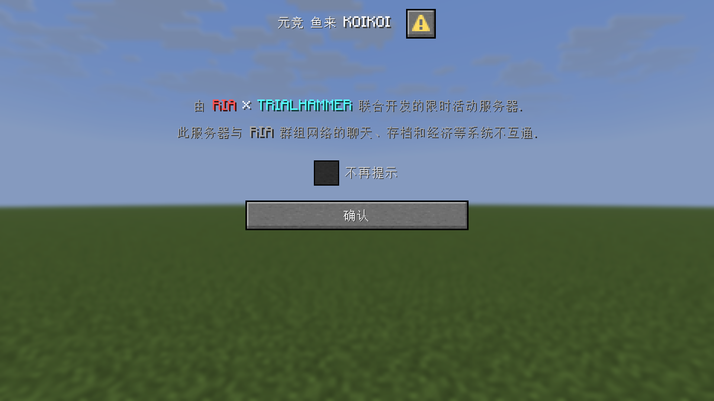
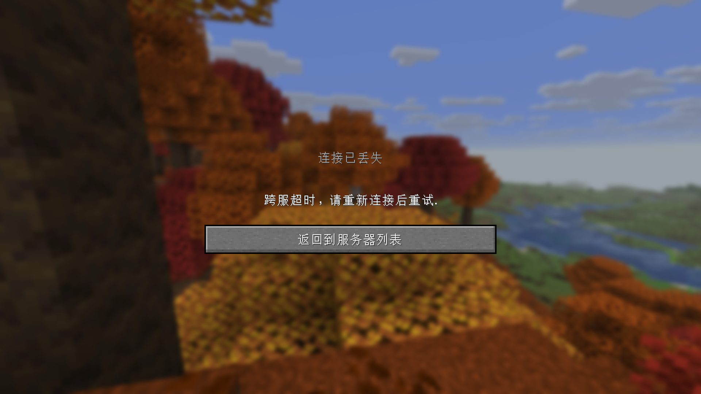

# ZthEvent2611Oj233Helper

元竞 鱼来 KOIKOI 活动服务器的进服引导插件，也可作为通用「提示 + 跨服命令」插件接入其他服务器。

插件会向玩家展示一个提示对话框：正文是活动说明，「不再提示」复选框默认不勾选，下方是确认 / 取消按钮。玩家确认后按配置的间隔重复执行跨服命令；真正的跨服由其他插件完成（例如 OhMyTransfer），本插件只负责提示、流程控制与命令触发。

## 运行模式

配置项 `managed` 控制两种用法：

| 模式 | `managed` | 行为 |
| --- | --- | --- |
| 托管模式（活动入口服） | `true` | 玩家进服后自动切换旁观并弹出对话框；确认后自动开始跨服；取消或超时会踢出玩家（客户端可由群组网络带回云端）。 |
| 通用模式（默认） | `false` | 进服时不做任何事；用 `/zth-event open [玩家]` 打开对话框；确认后执行跨服命令；取消只关闭对话框；命令尝试完仍在本服时只记录警告，不踢出玩家。 |

> 元竞 鱼来 KOIKOI 的活动入口服需要设置 `managed: true`。

## 功能特性

- 提示对话框：活动说明 + 「不再提示」复选框（默认不勾选）+ 确认 / 取消按钮。
  默认不允许 Esc 关闭；勾选「不再提示」并确认后按玩家 UUID 记录在独立的 `player-data.yml` 中，重启后依然生效。
- 确认后开始跨服流程，聊天栏显示「正在进行跨服......」（前后空行数量可配置）。
- 按配置的间隔执行一整组命令，例如每 10 秒一次、最多 3 次；命令由控制台执行，
  支持 `{player}`（玩家名）与 `{uuid}`（玩家 UUID）占位符。
- 托管模式下超时踢出玩家；通用模式下只记录警告。
- 玩家相关操作全部通过玩家的 EntityScheduler 调度，按 Paper / Folia 通用线程模型编写。
- 管理命令 `/zth-event`：打开对话框、开始引导、重载配置；`/zth-event open [玩家]` 也可供玩家使用。

## 环境要求

| 项目 | 要求 |
| --- | --- |
| 服务端 | Paper 26.1.2+（线程模型同时兼容 Folia） |
| 运行时 | Java 25 |
| 客户端 | 支持对话框的 Java 版客户端（Minecraft 1.21.6+） |
| 跨服插件 | 任意能通过命令触发跨服的插件（示例使用 OhMyTransfer 的 `/omt`） |

## 安装与快速开始

### 活动入口服（托管模式）

1. 将 jar 放入服务端的 `plugins/` 目录并启动一次服务器。
2. 在 `plugins/ZthEvent2611Oj233Helper/config.yml` 中设置 `managed: true`，并把 `flow.commands`
   改成实际的跨服命令（使用 OhMyTransfer 时通常是 `omt {player} koikoi`）。
3. `/zth-event reload` 或重启服务器生效。

玩家进服后应被切换为旁观模式并看到提示对话框；确认后开始跨服，取消则踢出（返回云端）。

### 其他服务器（通用模式，默认）

1. 将 jar 放入 `plugins/` 目录并启动一次服务器（无需额外配置，默认 `managed: false`）。
2. 按需修改 `flow.commands`（例如 BungeeCord 的 `server event` 命令）。
3. 由玩家执行 `/zth-event open`，或由管理员 `/zth-event open <玩家>`、其他插件调用
   `ZthEvent2611Oj233HelperPlugin#openDialog(Player)` 打开对话框。
4. 玩家确认后执行跨服命令；取消只关闭对话框。

## 流程说明

### 托管模式（`managed: true`）

| 阶段 | 行为 |
| --- | --- |
| 玩家进服 | 切换为旁观模式，弹出活动说明对话框 |
| 点击「确认」 | 若勾选了「不再提示」则记录下来；聊天栏显示「正在进行跨服......」，执行第 1 次跨服命令 |
| 点击「取消」 | 不开始跨服，直接踢出玩家（显示配置的取消消息），客户端自动回到云端 |
| 确认后 10 秒 | 第 2 次执行跨服命令 |
| 确认后 20 秒 | 第 3 次执行跨服命令 |
| 确认后 30 秒 | 玩家仍在本服则踢出，并显示配置的踢出消息 |
| 已勾选「不再提示」的玩家 | 进服后不弹窗，直接进入上面的跨服流程 |

### 通用模式（`managed: false`）

进服时不做任何事。`/zth-event open` 打开对话框后：

| 操作 | 行为 |
| --- | --- |
| 点击「确认」 | 聊天栏显示「正在进行跨服......」，按间隔执行跨服命令（次数可配置） |
| 点击「取消」 | 只关闭对话框，不踢出、不执行命令 |
| 命令执行完 | 记录警告日志，不踢出玩家 |

两种模式下，玩家在中途被传送到其他服务器（或自行退出）时，流程与后续任务都会自动结束。

## 效果

提示对话框（「不再提示」默认不勾选）：



超过总超时仍未离开本服时被踢出（托管模式）：



## 配置说明

配置文件为 `plugins/ZthEvent2611Oj233Helper/config.yml`，消息文本使用 MiniMessage 语法。

| 配置项 | 默认值 | 说明 |
| --- | --- | --- |
| `managed` | `false` | 运行模式，见上文「运行模式」 |
| `flow.start-on-join` | `true` | 托管模式下玩家进服是否自动开始引导流程 |
| `flow.gamemode` | `SPECTATOR` | 托管模式下开始引导时切换的游戏模式，`NONE` 表示不改变 |
| `flow.interval-seconds` | `10` | 确认后两次命令尝试之间的间隔（秒） |
| `flow.attempts` | `3` | 命令最多执行几次，总超时为两者相乘 |
| `flow.commands` | `["omt {player} koikoi"]` | 每次尝试执行的命令，由控制台执行 |
| `flow.kick-message` | `<gray>跨服超时，请重新连接后重试.</gray>` | 托管模式超时踢出时显示的消息 |
| `messages.gap-lines` | `1` | 聊天栏消息前后各留的空行数量 |
| `messages.transferring` | `<gray>正在进行跨服......</gray>` | 确认后显示的跨服进行中提示 |
| `messages.dialog.title` | `<white>元竞 鱼来 KOIKOI</white>` | 对话框标题 |
| `messages.dialog.body` | 活动说明 | 对话框正文，可写多行；空行显示为段落间距 |
| `messages.dialog.checkbox.key` | `dont_show_again` | 复选框表单字段名 |
| `messages.dialog.checkbox.label` | `不再提示` | 复选框文字 |
| `messages.dialog.checkbox.initial` | `false` | 复选框默认是否勾选 |
| `messages.dialog.checkbox.on-true` / `on-false` | `true` / `false` | 勾选、未勾选时提交的值 |
| `messages.dialog.confirm.label` | `确认` | 确认按钮文字 |
| `messages.dialog.confirm.tooltip` | 点击确认后开始跨服流程 | 确认按钮的悬停提示 |
| `messages.dialog.cancel.label` | `取消` | 取消按钮文字 |
| `messages.dialog.cancel.tooltip` | 取消并返回云端 | 取消按钮的悬停提示 |
| `messages.dialog.cancel.kick-message` | `已取消，正在返回云端.` | 托管模式点击取消后踢出玩家时显示的消息 |
| `messages.dialog.can-close-with-escape` | `false` | 是否允许 Esc 关闭对话框；`false` 时必须点击按钮 |

## 命令与权限

| 命令 | 权限 | 默认 | 说明 |
| --- | --- | --- | --- |
| `/zth-event open` | `zthevent2611.command.open` | 所有人 | 为自己打开提示对话框 |
| `/zth-event open <player>` | `zthevent2611.command.open.others` | op | 为指定玩家打开提示对话框 |
| `/zth-event start <player>` | `zthevent2611.command.start` | op | 托管模式：为玩家切换旁观并开始引导；通用模式：等同 open |
| `/zth-event reload` | `zthevent2611.command.reload` | op | 重载配置；新配置无效时保留旧配置 |
| — | `zthevent2611.bypass` | op | 托管模式下进服时跳过旁观模式切换与自动流程，便于管理员调试 |

命令通过 Paper 的 Brigadier API 注册，支持参数级补全与点击填入。

## 其他插件调用

需要在 NPC 交互、自定义菜单等处打开对话框时，可直接调用：

```java
ZthEvent2611Oj233HelperPlugin plugin = getPlugin(ZthEvent2611Oj233HelperPlugin.class);
plugin.openDialog(player);
```

## 数据文件

`plugins/ZthEvent2611Oj233Helper/player-data.yml` 记录选择过「不再提示」的玩家 UUID：

```yaml
notice-hidden:
  - 00000000-0000-0000-0000-000000000000
```

希望某个玩家重新看到自动弹出的提示时，从该列表中删除对应 UUID 并重载插件或重启服务器即可。
（用命令显式打开对话框不受该记录影响。）

## 构建

```bash
./gradlew build        # 编译、运行单元测试并打包
./gradlew test         # 只运行单元测试
```

产物位于 `build/libs/`（文件名包含版本号）。
默认使用 Paper 26.1.2 的 API 编译；如需针对其他版本编译，可覆盖 Gradle 属性：

```bash
./gradlew build -PpaperApiVersion=26.3.build.249-stable
```

## 常见问题

**玩家进服后没有弹窗、也没有被传送？**
托管模式下检查 `managed` 是否为 `true`、客户端是否支持对话框（Minecraft 1.21.6+）。
更老的客户端无法显示对话框，插件会退回聊天栏提示并直接开始跨服流程。

**管理员进服也被切换成旁观模式？**
给该管理员 `zthevent2611.bypass` 权限（默认 op 自带）后重新进服。

**玩家一直停在对话框上不确认？**
这是设计行为：确认前不会开始跨服，避免提示被跨服过程清掉。需要玩家点击「确认」后才会继续。

**玩家进服后一直没有被传送，最后被踢出？**
检查 `flow.commands` 与跨服插件的命令、目标服务器名是否一致；控制台会记录每次尝试的结果。

**想临时关闭托管模式的进服自动流程？**
把 `flow.start-on-join` 设为 `false`，需要时用 `/zth-event start <player>` 手动触发。

